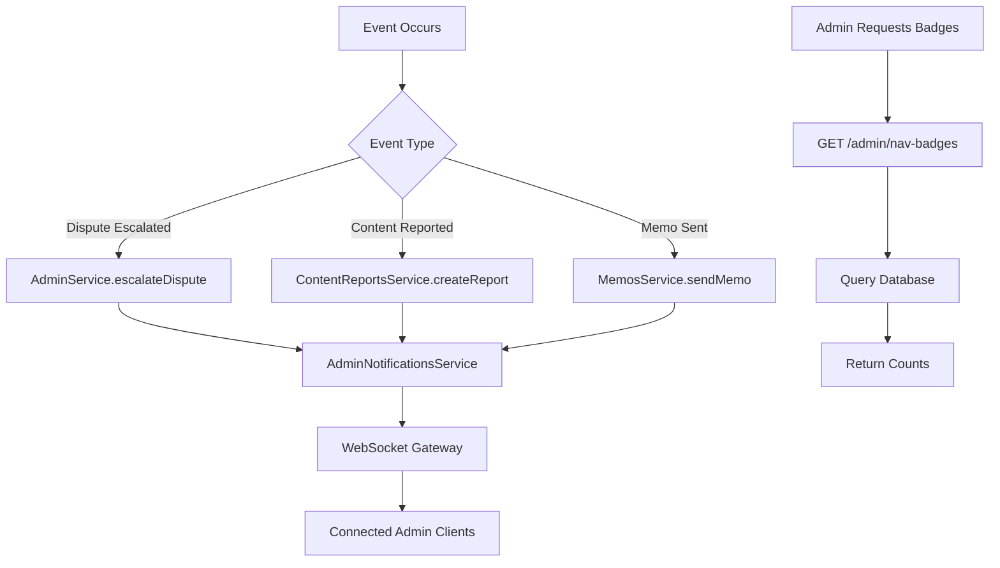
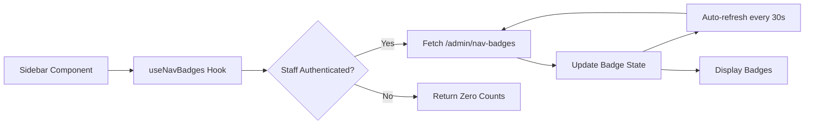

# Navigation Badges & Real-Time Notifications Guide

## 🎯 Overview

This document explains the new navigation badges and real-time notification features implemented in the Fretiko Admin Panel.

## ✨ Features Implemented

### 1. **Navigation Badges**
- **Disputes Badge**: Shows count of unresolved disputes (open + in_progress)
- **Reports Badge**: Shows count of pending content reports
- **Memos Badge**: Shows count of unread memos for the current staff member
- **Notifications Badge**: Shows count of unread admin notifications

### 2. **Real-Time WebSocket Notifications**
The notification bell in the header now connects via WebSocket and receives real-time updates for:
- New disputes
- Dispute escalations
- Content reports (products, services, chats, users)
- Memos (individual, department, platform-wide)
- System alerts

### 3. **Notification Triggers**
Notifications are automatically sent when:
- **Disputes**: A dispute is escalated to another department or super admins
- **Content Reports**: Users report content for moderation
- **Memos**: Staff sends a memo to individuals, departments, or all staff

---

## 📁 Files Created/Modified

### **Backend**

#### New Files:
None (all functionality added to existing files)

#### Modified Files:
1. **`fretiko-backend/src/admin/admin.service.ts`**
   - Added `getNavBadges()` method to fetch unread counts
   - Added `AdminNotificationsService` injection
   - Added notification trigger in `escalateDisputeForStaff()`

2. **`fretiko-backend/src/admin/admin.controller.ts`**
   - Added `GET /admin/nav-badges` endpoint

3. **`fretiko-backend/src/content-reports/content-reports.service.ts`**
   - Added `AdminNotificationsService` injection
   - Added notification trigger in `createContentReport()`

4. **`fretiko-backend/src/memos/memos.service.ts`**
   - Added `AdminNotificationsService` injection
   - Added notification triggers in `sendMemo()` for all recipient types

5. **`fretiko-backend/src/memos/memos.module.ts`**
   - Added `AdminModule` import to access `AdminNotificationsService`

### **Frontend**

#### New Files:
1. **`fretiko-admin/src/hooks/use-nav-badges.ts`**
   - React hook to fetch and auto-refresh navigation badge counts
   - Fetches every 30 seconds automatically

#### Modified Files:
1. **`fretiko-admin/src/components/layout/Sidebar.tsx`**
   - Added `useNavBadges` hook integration
   - Added badge display next to navigation items
   - Added `badgeKey` property to `NavItem` interface

---

## 🔧 How It Works

### Backend Flow



### Frontend Flow



### Database Queries

The `getNavBadges()` method runs 4 parallel queries:

```typescript
// 1. Unresolved disputes
SELECT COUNT(*) FROM disputes 
WHERE status IN ('open', 'in_progress')

// 2. Pending content reports
SELECT COUNT(*) FROM content_reports 
WHERE status = 'pending'

// 3. Unread memos (for current staff)
SELECT COUNT(*) FROM memos 
WHERE recipient_id = :staffId 
AND is_read = false

// 4. Unread admin notifications
SELECT COUNT(*) FROM admin_notifications 
WHERE staff_id = :staffId 
AND is_read = false 
AND is_deleted = false
```

---

## 🚀 Testing Guide

### 1. Test Navigation Badges

**Setup:**
- Log in as a staff member
- Ensure there are some unresolved disputes, pending reports, or unread memos

**Expected Behavior:**
- Sidebar navigation items show red badges with counts
- Badges show "99+" for counts over 99
- Badges auto-refresh every 30 seconds

**Test Steps:**
1. Open admin panel → Check sidebar badges
2. Create a new dispute → Badge count should increase (may take up to 30s)
3. Resolve a dispute → Badge count should decrease
4. Send a memo to yourself → Memos badge should increase

### 2. Test Real-Time Notifications

**Setup:**
- Open admin panel in two browser tabs (or two users)
- Ensure WebSocket is connected (check browser console for "✅ Admin notifications WebSocket connected")

**Test Steps:**

#### Test Dispute Escalation:
1. **Tab 1**: Log in as staff, escalate a dispute
2. **Tab 2**: Check notification bell → Should receive real-time notification
3. Click notification → Should navigate to `/dashboard/disputes`

#### Test Content Report:
1. **Tab 1**: Create a content report (as a regular user via API or app)
2. **Tab 2** (moderator): Check notification bell → Should receive notification
3. Badge count should increase immediately

#### Test Memos:
1. **Tab 1**: Send a memo to a specific staff member
2. **Tab 2** (recipient): Should receive notification immediately
3. Click notification → Should navigate to `/dashboard/memos`

### 3. Test Badge Refresh

**Test Steps:**
1. Open admin panel
2. Note the current badge counts
3. Wait 30 seconds
4. Check if badges update (if any backend data changed)

### 4. Test Error Handling

**Test Steps:**
1. Disconnect internet → Badges should show last known counts
2. Reconnect → Badges should refresh within 30 seconds
3. Check browser console for any errors

---

## 🐛 Troubleshooting

### Badges Not Showing

**Possible Causes:**
1. **Authentication Issue**: Staff token not valid
   - **Solution**: Log out and log back in

2. **API Endpoint Not Working**: `/admin/nav-badges` returning error
   - **Solution**: Check backend logs, ensure `AdminService.getNavBadges()` is working

3. **Hook Not Running**: `useNavBadges` hook not fetching
   - **Solution**: Check browser console, ensure no JavaScript errors

### Badges Not Updating

**Possible Causes:**
1. **Auto-refresh Not Working**: 30-second interval not running
   - **Solution**: Check if component is unmounting/remounting frequently

2. **Stale Data**: Backend cache or database lag
   - **Solution**: Manually refresh page, check backend database

### WebSocket Not Connecting

**Possible Causes:**
1. **Backend Gateway Not Running**: `AdminNotificationsGateway` not initialized
   - **Solution**: Check backend startup logs for WebSocket initialization

2. **CORS Blocking**: WebSocket connection blocked by CORS policy
   - **Solution**: Ensure WebSocket URL is whitelisted in CORS config

3. **Authentication Failing**: Staff JWT not valid for WebSocket
   - **Solution**: Check JWT secret matches between REST API and WebSocket

### Notifications Not Triggering

**Possible Causes:**
1. **Service Not Injected**: `AdminNotificationsService` not properly injected
   - **Solution**: Ensure `AdminModule` is imported in relevant modules

2. **Method Not Called**: Notification trigger code not reached
   - **Solution**: Add debug logs, check if service methods are executing

3. **Database Error**: Notification insertion failing
   - **Solution**: Check backend logs for Supabase errors

---

## 📊 Performance Considerations

### Badge Fetch Frequency
- **Current**: Every 30 seconds
- **Impact**: Minimal (4 simple COUNT queries)
- **Optimization**: Can be increased to 60 seconds if needed

### WebSocket Connections
- **Scalability**: Each connected admin maintains 1 WebSocket connection
- **Memory**: ~1-2KB per connection
- **Max Connections**: Limited by server resources (typically 10,000+ concurrent)

### Database Load
- **Badges**: 4 queries per staff member every 30 seconds
- **Notifications**: INSERT on event + SELECT for recipients
- **Indexes**: Ensure indexes exist on `status`, `is_read`, `staff_id` columns

---

## 🔮 Future Enhancements

1. **Badge Customization**
   - Allow staff to choose which badges to display
   - Custom refresh intervals per badge

2. **Advanced Filtering**
   - Badge counts filtered by priority or date range
   - Department-specific badges

3. **Browser Notifications**
   - Desktop push notifications (already implemented in `NotificationBell.tsx`)
   - Sound alerts for high-priority notifications

4. **Badge Animations**
   - Pulse effect for new items
   - Color coding by priority

5. **Real-Time Badge Updates**
   - Use WebSocket to update badges immediately (instead of 30s polling)
   - Push badge updates when events occur

---

## 📝 API Reference

### `GET /admin/nav-badges`

**Description**: Fetch navigation badge counts for current staff member

**Authentication**: Staff JWT required

**Response**:
```json
{
  "disputes": 5,
  "reports": 12,
  "memos": 3,
  "orders": 0,
  "notifications": 8
}
```

**Error Codes**:
- `401`: Unauthorized (invalid or missing token)
- `403`: Forbidden (not a staff user)
- `500`: Internal server error

---

## 🎉 Summary

The navigation badges feature enhances the admin panel UX by:
- ✅ Providing at-a-glance visibility of pending tasks
- ✅ Auto-refreshing to keep data current
- ✅ Integrating seamlessly with existing real-time notifications
- ✅ Supporting all major admin workflows (disputes, reports, memos)

This feature works in conjunction with the existing WebSocket notification system to provide a comprehensive real-time admin experience.

